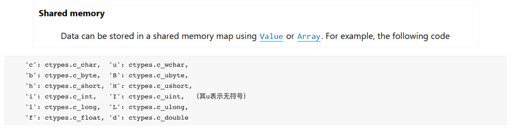
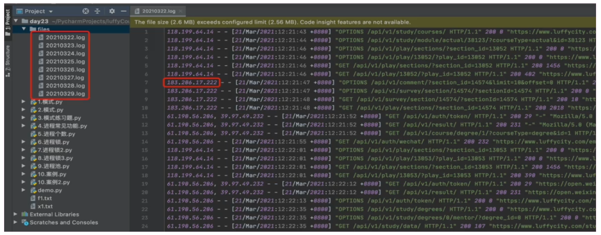

---
aliases:
  - course of study
  - course
tags:
  - tutorial
  - computer-science
category: knowledge
datetime: " 2026-08-15 11:08:13 周六"
author: wephiles
rating: "0"
---
<h1 style="text-align: center;">overview</h1>

进程是计算机中资源分配最小的单位，一个进程中可以有多个线程，同一个进程中的线程共享资源。

进程与进程之间则是相互隔离。

`Python` 中通过多进程可以利用CPU的多核优势，计算密集型操作适用于多进程。

```python
with ProcessPoolExecutor(max_workers=NUM_PROCESSES) as executor:
        futures = []
        for chunk in gen_chunks(INPUT_PATH):
            # executor.submit() -- 逐个提交，返回单个 Future 对象，按提交顺序依次入队
            # executor.map() -- 批量调用，结果顺序与输入顺序严格一致，只能传一个可迭代参数，多个参数需 zip 打包
            # as_completed() -- 谁先完成先处理谁
            # wait() -- 等待一批任务到达某个状态
            # add_done_callback() -- 回调函数 不阻塞主进程
            future = executor.submit(process_task, args)
            futures.append(future)
            
         for future in as_completed(futures):  # 这样写的话，程序不会管提交顺序，哪个先结束先输出哪个
             future.result()
    
for future in futures:  # 这样写的话，程序会按照提交顺序，即使排在后面的已经完成了，但是还是需要等排在前面的结束才能继续输出
    future.result()
```

关于幂等性：


关于断点续跑：

**核心思路**：把任务拆成**固定编号的分片**，每个分片的产出是一个独立文件。约定：

> **分片文件完整存在 = 这个分片已成功处理完毕；不存在 = 需要重做。**

崩溃时，已完成的分片文件留在磁盘上，重跑时检测到就跳过——这就是断点续跑。

==保证“完整存在”的关键：`os.replace` 原子重命名==

子进程**不能直接写最终分片文件**（写到一半崩溃，残留半个文件，重跑时会误以为已完成）。所以采用两步：

1. 先写**临时文件** `xxx.tmp`
2. 全部写完后，`os.replace(tmp, final)` ——这是**操作系统级的原子操作**：在任意瞬间，final 要么不存在，要么是完整内容，**绝不会出现半个文件**

这样“final 存在”就成了可靠的完成标记。

# 1. 进程

```python
import multiprocessing

def task():
    pass

if __name__ == '__main__':
    p = multiprocessing.Process(target=task)
    p.start()
```

```python
import multiprocessing

def task(arg):
    pass

def run():
    p = multiprocessing.Process(target=task, args=('xxx',))
    p.start()

if __name__ == '__main__':
    run()
```

## 1.1 主进程和子进程

每个python脚本运行时会创建一个进程(主进程)，如果我们手动创建子进程：

### 1.1.1 `fork` 方法创建子进程

子进程几乎拷贝父进程所有资源，子进程里面对资源的操作和主进程对资源的操作互不影响；另外，文件对象/线程锁等资源既会拷贝，又可以通过参数传递。

#### 1.1.1.1 示例一（Linux 系统运行）：

```python
# /usr/bin/env python
# -*- coding: utf-8 -*-

"""
测试多线程 —— fork 创建子进程
"""

import multiprocessing


def task():
    print("子进程:", name)


name = []

if __name__ == "__main__":
    name.append(123)
    print("主进程:", name)
    p = multiprocessing.Process(target=task)
    p.start()

    # print(f"当前默认启动方法: {multiprocessing.get_start_method()}")
    # # 也可以获取所有可用的启动方法
    # print(f"所有可用的启动方法: {multiprocessing.get_all_start_methods()}")
```

输出结果：

```
主进程: [123]
子进程: []
```

注意：

即使在 Linux 上使用 `fork` 启动方法，官方文档仍然强烈建议使用 `if __name__ == '__main__'`，原因如下：

| 情况                        | 是否需要 `if __name__ == '__main__'` | 原因                                                         |
| :-------------------------- | :----------------------------------- | :----------------------------------------------------------- |
| **`fork (Linux 默认)`**     | **强烈建议**                         | 虽然不会立即报错，但可能导致：1. 意外递归创建进程；2. 资源泄漏；3. 调试困难；4. 与其他启动方法不兼容 |
| **`forkserver`**            | **必须**                             | 子进程会重新导入模块，不加保护会导致无限递归                 |
| **`spawn (Windows/macOS)`** | **必须**                             | 子进程会重新导入模块，不加保护会导致无限递归                 |

#### 1.1.1.2 示例二（Linux 系统运行）

```
# /usr/bin/env python
# -*- coding: utf-8 -*-

"""
测试多线程 —— fork 创建子进程
"""

import multiprocessing


def task():
    print("append 前子进程:", name)
    name.append(123)
    print("append 后子进程:", name)


name = [456]

if __name__ == "__main__":
    print("主进程前:", name)
    p = multiprocessing.Process(target=task)
    p.start()
    print("主进程后:", name)
```

 输出结果:

```
主进程前: [456]
主进程后: [456]
append 前子进程: [456]
append 后子进程: [456, 123]
```

### 1.1.2 `spawn` 模式创建子进程

不会拷贝主进程的资源 需要手动去传输一些必备的值, ⚠️⚠️⚠️**注意:spawn下对于一些特殊的(文件对象/锁),子进程不会拷贝这些对象，与此同时通过参数传递也不可以!!! -- 需要自己去子进程中再去重新创建一遍！**⚠️⚠️⚠️

#### 1.1.2.1 示例一

```python
import multiprocessing


def task():
    print(f'name: {name}')


if __name__ == '__main__':
    name = [1, 2, 3]
    p = multiprocessing.Process(target=task)
    p.start()
```

输出: 会报错

```
Process Process-1:
Traceback (most recent call last):
  File "D:\Software\Python\Lib\multiprocessing\process.py", line 320, in _bootstrap
    self.run()
    ~~~~~~~~^^
  File "D:\Software\Python\Lib\multiprocessing\process.py", line 108, in run
    self._target(*self._args, **self._kwargs)
    ~~~~~~~~~~~~^^^^^^^^^^^^^^^^^^^^^^^^^^^^^
  File "E:\Code\PyProjects\Demos\exercise\src\exercise\multi_threading\demo_03.py", line 21, in task
    print(f'name: {name}')
                   ^^^^
NameError: name 'name' is not defined
```


#### 1.1.2.2 示例二: 需要手动传递资源

```python
import multiprocessing


def task(name):
    print(f'name: {name}')


if __name__ == '__main__':
    name = [1, 2, 3]
    p = multiprocessing.Process(target=task, args=(name,))
    p.start()
```

输出结果:

```python
name: [1, 2, 3]
```


#### 1.1.2.3 示例三: 传递过去后也是复制一份

```python
import multiprocessing


def task(data):
    print('before sub process:', data)
    data.append('four')
    print('after sub process:', data)


if __name__ == '__main__':
    name = [1, 2, 3]
    print('before main process:', name)
    p = multiprocessing.Process(target=task, args=(name,))
    p.start()
    p.join()
    print('after main process:', name)
```

输出结果:

```python
before main process: [1, 2, 3]
before sub process: [1, 2, 3]
after sub process: [1, 2, 3, 'four']
after main process: [1, 2, 3]
```

#### 1.1.2.4 示例四

```python
import multiprocessing


def task(fp, l):
    print(fp, l)


if __name__ == '__main__':
    f = open('data.txt')
    lock = multiprocessing.Lock()

    p = multiprocessing.Process(target=task, args=(f, lock,))
    p.start()
    p.join()
```

输出: 报错

```python
Traceback (most recent call last):
  File "E:\Code\PyProjects\Demos\exercise\src\exercise\multi_threading\demo_03.py", line 29, in <module>
    p.start()
    ~~~~~~~^^
  File "D:\Software\Python\Lib\multiprocessing\process.py", line 121, in start
    self._popen = self._Popen(self)
                  ~~~~~~~~~~~^^^^^^
  File "D:\Software\Python\Lib\multiprocessing\context.py", line 230, in _Popen
    return _default_context.get_context().Process._Popen(process_obj)
           ~~~~~~~~~~~~~~~~~~~~~~~~~~~~~~~~~~~~~~~~~~~~~^^^^^^^^^^^^^
  File "D:\Software\Python\Lib\multiprocessing\context.py", line 343, in _Popen
    return Popen(process_obj)
  File "D:\Software\Python\Lib\multiprocessing\popen_spawn_win32.py", line 97, in __init__
    reduction.dump(process_obj, to_child)
    ~~~~~~~~~~~~~~^^^^^^^^^^^^^^^^^^^^^^^
  File "D:\Software\Python\Lib\multiprocessing\reduction.py", line 60, in dump
    ForkingPickler(file, protocol).dump(obj)
    ~~~~~~~~~~~~~~~~~~~~~~~~~~~~~~~~~~~^^^^^
TypeError: cannot pickle 'TextIOWrapper' instances
when serializing tuple item 0
when serializing dict item '_args'
when serializing multiprocessing.context.Process state
when serializing multiprocessing.context.Process object
```

#### 1.1.2.5 关于传递给子进程文件对象时出错

> 为什么报错:

`multiprocessing` 在创建子进程时，需要将传递给子进程的参数**序列化（pickle）**，然后通过进程间通信传递过去。问题在于：

- 文件对象无法被序列化
  ```python
  import pickle
  
  f = open('./multi_threading/data.txt')
  pickle.dumps(f)
  
  # ❌ 错误信息如下:
  # Traceback (most recent call last):
  #   File "E:\Code\PyProjects\Demos\exercise\src\exercise\main.py", line 20, in <module>
  #     pickle.dumps(f)  # ❌ TypeError: cannot pickle 'file' object
  #     ~~~~~~~~~~~~^^^
  # TypeError: cannot pickle 'TextIOWrapper' instances
  ```

  **文件对象是操作系统资源句柄，无法被序列化**，因此无法通过 `args` 传递给子进程。

- 锁的传递也有限制
  虽然 `multiprocessing.Lock()` 本身是可以被序列化的（在 Linux 的 `fork` 模式下可以直接继承），但在使用 `spawn` 或 `forkserver` 启动方法时（如你的 `WSL` 环境），锁对象也可能出现序列化问题。

> 解决方法

方案一: 最简单的方法是让每个子进程自己打开文件.

```python
import multiprocessing


def task(filename, lock=None):
    with lock if lock else multiprocessing.NullContext():
        with open(filename, 'r') as f:
            content = f.read()
            print(f"读取内容: {content}")


if __name__ == '__main__':
    filename = 'data.txt'
    lock = multiprocessing.Lock()

    p = multiprocessing.Process(target=task, args=(filename, lock))
    p.start()
    p.join()

```

方案二: 使用 `Pool` + 文件名传递

如果使用进程池，也是同样的思路：

```python
import multiprocessing


def task(filename):
    with open(filename, 'r') as f:
        return f.read()


if __name__ == '__main__':
    filename = 'data.txt'
    
    with multiprocessing.Pool(processes=2) as pool:
        results = pool.map(task, [filename, filename])
        for result in results:
            print(result)

```

方案三: 使用共享文件描述符(高级用法, 仅限 `Linux/Unix`)

如果你**必须在父进程中打开文件**并传递给子进程（例如文件已经以特定模式打开），可以使用 `multiprocessing.Pipe` 或 `multiprocessing.Connection` 来传递文件描述符：

```python
import multiprocessing
import os


def task(conn):
    # 从连接接收文件描述符
    fd = conn.recv_fd()
    # 使用 os.fdopen 创建文件对象
    with os.fdopen(fd, 'r') as f:
        content = f.read()
        print(f"子进程读取内容: {content}")


if __name__ == '__main__':
    filename = 'data.txt'
    
    # 在父进程中打开文件
    f = open(filename, 'r')
    
    # 创建管道
    parent_conn, child_conn = multiprocessing.Pipe(duplex=True)
    
    # 启动子进程
    p = multiprocessing.Process(target=task, args=(child_conn,))
    p.start()
    
    # 通过管道发送文件描述符
    parent_conn.send_fd(f.fileno())
    
    # 关闭管道连接
    child_conn.close()
    parent_conn.close()
    
    p.join()
    f.close()

```

方案四:  使用 `multiprocessing.Manager`（适用于需要在进程间共享文件）:

如果多个子进程需要访问同一个文件，可以使用 `Manager` 来管理资源：

```python
import multiprocessing


def task(filename, manager_lock):
    with manager_lock:
        with open(filename, 'r') as f:
            content = f.read()
            print(f"进程 {multiprocessing.current_process().pid} 读取: {content}")


if __name__ == '__main__':
    filename = 'data.txt'
    
    # 使用 Manager 创建共享锁
    with multiprocessing.Manager() as manager:
        lock = manager.Lock()
        
        processes = []
        for i in range(3):
            p = multiprocessing.Process(target=task, args=(filename, lock))
            p.start()
            processes.append(p)
        
        for p in processes:
            p.join()

```

个方案对比:

| 方案                 | 优点                     | 缺点                    | 适用场景                     |
| :------------------- | :----------------------- | :---------------------- | :--------------------------- |
| **子进程中打开文件** | ✅ 简单、跨平台、安全     | ❌ 每个进程独立打开文件  | 大多数场景，**推荐**         |
| **Pool + 文件名**    | ✅ 高效、自动管理进程     | ❌ 需要使用 Pool         | 批量处理多个文件             |
| **传递文件描述符**   | ✅ 父进程控制文件打开方式 | ❌ 仅限 Unix/Linux、复杂 | 特殊需求，如共享同一文件位置 |
| **Manager**          | ✅ 进程间共享资源         | ❌ 性能开销较大          | 需要进程间协调的复杂场景     |

#### 1.1.2.6 关于锁的使用

`lock = multiprocessing.Lock()` 是正确的，锁本身可以被序列化。但要注意：

锁的正确使用方式:

```python
import multiprocessing
import time


def task(filename, lock):
    with lock:  # 使用上下文管理器自动获取/释放锁
        with open(filename, 'a') as f:
            f.write(f"进程 {multiprocessing.current_process().pid} 写入数据\n")
            time.sleep(0.1)  # 模拟耗时操作


if __name__ == '__main__':
    filename = 'data.txt'
    lock = multiprocessing.Lock()
    
    processes = []
    for i in range(5):
        p = multiprocessing.Process(target=task, args=(filename, lock))
        p.start()
        processes.append(p)
    
    for p in processes:
        p.join()
    
    # 查看写入结果
    with open(filename, 'r') as f:
        print("文件内容:")
        print(f.read())

```

#### 1.1.2.7 常见错误总结

```python
# ❌ 错误 1：传递文件对象
f = open('data.txt')
p = multiprocessing.Process(target=task, args=(f,))
# TypeError: cannot pickle '_io.TextIOWrapper' object

# ❌ 错误 2：在 spawn/forkserver 模式下传递某些不可序列化的对象
# 在 Windows 或使用 spawn/forkserver 时，某些对象无法传递

# ❌ 错误 3：忘记关闭文件
f = open('data.txt')
p = multiprocessing.Process(target=task, args=('data.txt',))
p.start()
# 忘记 f.close() 可能导致资源泄漏

# ✅ 正确做法：传递文件名，在子进程中打开
p = multiprocessing.Process(target=task, args=('data.txt', lock))
p.start()
p.join()
```

#### 1.1.2.8 核心原则

1. **只传递可序列化的对象**：基本类型（int, str, list, dict 等）和 multiprocessing 专用对象（Lock, Queue, Pipe 等）
2. **文件名代替文件对象**：传递文件路径字符串，让子进程自己打开文件
3. **使用上下文管理器**：用 `with` 语句确保文件和锁正确释放
4. **考虑启动方法的影响**：不同的启动方法对序列化的要求不同

### 1.1.3 `forkserver` 模式创建子进程

和 `spqwn` 一样,通过 `run` 方法去完成

### 1.1.4 补充

关于在 `Python` 中基于 `multiprocessing` 模块操作的进程:

官方文档: https://docs.python.org/zh-cn/3.14/library/multiprocessing.html


### 1.1.5 案例

案例一

```python
# Linux(fork)

import multiprocessing
import time


def task():
    print(name)

    # 此时 file_object 已经写入了 abc\n
    file_object.write('def\n')  # 又写入了 def\n --> 现在子进程的进程空间中已经写入了 abc\ndef\n
    file_object.flush()  # 刷入硬盘  --> 硬盘中已经写入了 abc\ndef\n


if __name__ == '__main__':
    name = []
    file_object = open('x.txt', 'a+', encoding='utf-8')  
    file_object.write('abc\n')  # 写入内存，主进程在自己的进程空间（内存）中写入abc\n

    p = multiprocessing.Process(target=task,)  # 创建子进程，子进程完全拷贝主进程 转到 task 函数
    p.start()

    # 子进程结束后，task 函数结束，转到主进程，主进程在结束之间还会将自己的进程空间里的内容写入磁盘：将 abc\n 刷入磁盘
	
```


案例二:

```python
import multiprocessing
import time


def task():
    print(name)
    file_object.write('def\n')
    file_object.flush()


if __name__ == '__main__':
    name = []
    file_object = open('x.txt', 'a+', encoding='utf-8')  
    file_object.write('abc\n')
    file_object.flush()  # 刷入磁盘后，主进程释放进程空间

    p = multiprocessing.Process(target=task,)
    p.start()
```


案例三:

```python
import time
import threading
import multiprocessing


def task():
    # 拷贝的锁是被申请走的状态
    # 问题：被谁申请走了呢？
    # 	被子进程中的主线程申请走了
    print(lock)
    
    # with lock:
    #     print('执行中...')
    
    # 如果将上面两行改成下面这两行后：print(666) 是可以执行的 -- 因为 lock 会锁住除了主线程之外的线程！！！
    lock.acquire()
	print(666)  # 这一句是可以执行的 -- 因为我们用的是 RLock

if __name__ == '__main__':
    name = []
    lock = threading.RLock()
    print('acquire前:', lock)
    lock.acquire()  # 申请锁 -- 被主进程中的主线程申请走了
    print('acquire后:', lock)

    p = multiprocessing.Process(target=task,)
    p.start()
    
```


## 1.2 常用功能

进程的常见方法：

- `p.start()` 当前进程准备就绪，等待被CPU调度（工作单元其实是进程中的线程）

- `p.join()` 等待当前进程的任务执行完毕后再向下继续执行

```python
# spawn:

import time
from multiprocessing import Process

def task(arg):
    time.sleep(2)
    print('执行中...')
    
    
if __name__ == '__main__':
    p = Process(target=task, args=('xxx',))
    p.start()
    p.join()
    
    print('继续执行...')
```

- `p.daemon = 布尔值`  ，守护进程（必须放在 start 之前）

  - `p.daemon = True` 设置为守护进程，主进程执行完毕之后，子进程也会关闭
  - `p.daemon = False` 设置为非守护进程，主进程等待子进程，子进程执行完毕后，主进程才结束

  ```python
  import time
  from multiprocessing import Process
  
  
  def task(arg):
      time.sleep(2)
      print('执行中...')
  
  
  if __name__ == '__main__':
      p = Process(target=task, args=('xxx',))
      p.daemon = True
      p.start()
  
      print('继续执行')
  ```

- 进程的名称设置和获取

  ```python
  import time
  import multiprocessing 
  
  
  def task(arg):
      time.sleep(2)
      print('name:', multiprocessing.current_process().name)
  
  
  if __name__ == '__main__':
      p = multiprocessing.Process(target=task, args=('xxx',))
      p.name = '哈哈哈哈'
      p.start()
  ```

  ```python
  import os
  import time
  import threading
  import multiprocessing
  
  
  def func():
      time.sleep(1)
  
  
  def task(arg):
      for i in range(10):
          threading.Thread(target=func).start()
  
      print('当前进程内的线程个数:', len(threading.enumerate()))
      print('当前进程内的线程(top-3):', threading.enumerate()[0:3])
  
      print('son:', os.getpid())  # 获取进程号
      # 获取 父进程的 进程ID
      print('son->parent:', os.getppid())
      print('name:', multiprocessing.current_process().name)
  
  
  if __name__ == '__main__':
      import psutil
  
      print('main:', os.getpid())  # 获取进程号
      p = multiprocessing.Process(target=task, args=('xxx',))
      p.name = 'sub_process_of_main'
      p.start()
      print('主进程内的子进程个数:', len(psutil.Process().children(recursive=False)))
      print('主进程内的线程个数:', len(threading.enumerate()))
  ```

  输出结果:

  ```python
  main: 26348
  主进程内的子进程个数: 1
  主进程内的线程个数: 1
  当前进程内的线程个数: 11
  当前进程内的线程(top-3): [<_MainThread(MainThread, started 10832)>, <Thread(Thread-1 (func), started 7056)>, <Thread(Thread-2 (func), started 26492)>]
  son: 16368
  son->parent: 26348
  name: sub_process_of_main
  ```

  

- 自定义进程类: 直接将进程需要做的事情写到 run 方法中

  ```python
  import multiprocessing
  
  
  class MyProcess(multiprocessing.Process):
      def run(self):
          print('执行此进程', self._args)
  
  
  if __name__ == '__main__':
      p = MyProcess(args=('xxx',))
      p.start()
      print('继续执行...')
  ```

  输出结果:

  ```python
  继续执行...
  执行此进程 ('xxx',)
  ```

- CPU 个数: 一般而言, CPU 有几颗核心, 就创建几个进程

  ```python
  import multiprocessing
  import os
  
  print(multiprocessing.cpu_count())
  print(os.cpu_count())
  ```

## 1.3 进程间数据共享

进程是资源分配的最小单元，每个进程都维护自己独立的资源，不共享。

```python
import multiprocessing


def task(data):
    data.append(666)
    print('子进程:', data)


if __name__ == '__main__':
    data_list = [999, ]
    p = multiprocessing.Process(target=task, args=(data_list,))
    p.start()
    p.join()

    print('主进程:', data_list)
    
# ===============
子进程: [999, 666]
主进程: [999]
```

如果想要让他们之间进行通信，则可以借助一些特殊的东西来实现。

### 1.3.1 共享内存



```python
from multiprocessing import Process, Value, Array


def func(n, m1, m2):
    n.value = 888
    m1.value = 'a'.encode('utf-8')
    m2.value = '数'
    
    
if __name__ == '__main__':
    num = Value('i', 666)
    v1 = Value('c')
    v2 = Value('u')
    
    p = Process(target=func, args=(num, v1, v2, ))
    p.start()
    p.join()
    
    print(num.value)  # 888
    print(v1.value)  # b'a'
    print(v2.value)  # '数'
```

```python
from multiprocessing import Process, Value, Array


def func(data_array):
    data_array[0] = 66666


if __name__ == '__main__':
    arr = Array('i', [1, 2, 3, 4])  # 和 C 中的数组一样，每个元素必须是 ‘i’(int) 并且长度不可变

    p = Process(target=func, args=(arr,))
    p.start()
    p.join()

    # <SynchronizedArray wrapper for <multiprocessing.sharedctypes.c_long_Array_4 object at 0x0000023B3762A440>>
    print(arr)
    
    print(arr[:])  # [66666, 2, 3, 4]
```

### 1.3.2 服务器进程


```python
from multiprocessing import Process, Manager


def func(d, l, s):
    d[1] = '1'
    d['2'] = 2
    d[0.25] = None
    l.reverse()
    s.add('a')
    s.add('b')

if __name__ == '__main__':
    with Manager() as manager:
        d = manager.dict()
        l = manager.list(range(10))
        s = manager.set()

        p = Process(target=func, args=(d, l, s))
        p.start()
        p.join()

        print(d)
        print(l)
        print(s)
```

```python
{1: '1', '2': 2, 0.25: None}
[9, 8, 7, 6, 5, 4, 3, 2, 1, 0]
{'a', 'b'}
```

### 1.3.3 交换


- Queues
  `The Queue class is a near clone of queue. Queue. For example:`

  ```python
  from multiprocessing import Process, Queue
  
  
  def func(queue):
      queue.put([42, None, 'hello', 12.5])
  
  
  if __name__ == '__main__':
      # Queue 类几乎是 queue.Queue 类的克隆
      queue = Queue()
      p = Process(target=func, args=(queue,))
      p.start()
      print(queue.get())  # Queue 是线程安全的, 也是进程安全的, 任何放入多处理队列的对象都会被序列化。
      p.join()
  ```

  

- Pipes

  

  ```python
  from multiprocessing import Process, Pipe
  
  def func(conn):
      conn.send([42, None, 'hello'])
      conn.close()
  
  if __name__ == '__main__':
      # Pipe（） 函数返回一对连接对象，这些对象通过默认为全双工（双向）管道连接。例如：
      parent_conn, child_conn = Pipe()
      p = Process(target=func, args=(child_conn,))
      p.start()
      print(parent_conn.recv())   # prints "[42, None, 'hello']" --> 阻塞 等待子进程发送数据
      p.join()
  ```

  

  ```python
  Pipe() 返回的两个连接对象代表管道的两端。每个连接对象都有 send() 和 recv() 方法（以及其他方法）。注意，如果两个进程（或线程）同时尝试从管道同一端读取或写入，管道中的数据可能会损坏。当然，同时使用管道不同端的进程不存在损坏风险。
  
  send() 方法序列化对象，recv() 重新创建对象。
  ```

---

上述都是 Python 内部提供的进程之间数据共享和交换的机制，作为了解即可，在项目开发中很少使用，后期项目中一般会借助第三方的一些工具来做资源的共享，比如：`MySQL` 数据库、`redis`等。


## 1.4 进程锁

如果多个进程抢占式去做某个操作，为了防止操作出现问题，可以通过进程锁来避免。

```python
import time
from multiprocessing import Process, Value, Array, Lock


def func(n):
    n.value = n.value + 1


if __name__ == '__main__':

    num = Value('i', 0)
    for i in range(20):
        p = Process(target=func, args=(num,))
        p.start()
    time.sleep(1)
    print(num.value)  # 有时候打印 19，有时候打印 20
```

```python
from multiprocessing import Process, Manager


def task(d):
    d[0] += 1


if __name__ == '__main__':
    with Manager() as manager:
        d = manager.dict()
        d[0] = 10

        process = []
        for i in range(5):
            p = Process(target=task, args=(d,))
            process.append(p)
            p.start()

        for p in process:
            p.join()

        print(d)
```

```python
{0: 15}
```

---

```python
import time
import multiprocessing

def task():
    # 假设文件中保存的内容就是一个值： 10
    with open('f1.txt', 'r', encoding='utf-8') as fp:
        current_num = int(fp.read())
        
    print('排队抢票了')
    time.sleep(1)
    
    current_num -= 1
    with open('f1.txt', 'w', encoding='utf-8') as fp:
        fp.write(str(current_num))
    

if __name__ == '__main__':
    for i in range(20):
        p = multiprocessing.Process(target=task,)
        p.start()

```

很显然，多进程在操作时就会出现问题，此时就需要锁介入:

```python
import time
import multiprocessing


def task(lock):
    print('开始')
    lock.acquire()
    # 假设文件中保存的内容就是一个值： 10
    with open('f1.txt', 'r', encoding='utf-8') as fp:
        current_num = int(fp.read())

    print('排队抢票了')
    time.sleep(1)

    current_num -= 1
    with open('f1.txt', 'w', encoding='utf-8') as fp:
        fp.write(str(current_num))
    lock.release()


if __name__ == '__main__':
    lock = multiprocessing.RLock()  # 进程锁
    for i in range(20):
        p = multiprocessing.Process(target=task, args=(lock,))  # 进程锁是可以当参数传递进去的 但是线程锁不可以！！！
        p.start()
    
```

按照上面的操作在 mac 电脑上，spawn 启动方式有可能会报错，所以无论在什么情况下，应该像下面这样写：

```python
import time
import multiprocessing


def task(lock):
    print('开始')
    lock.acquire()
    # 假设文件中保存的内容就是一个值： 10
    with open('f1.txt', 'r', encoding='utf-8') as fp:
        current_num = int(fp.read())

    print('排队抢票了')
    time.sleep(1)

    current_num -= 1
    with open('f1.txt', 'w', encoding='utf-8') as fp:
        fp.write(str(current_num))
    lock.release()


if __name__ == '__main__':
    lock = multiprocessing.RLock()  # 进程锁
    processes = []
    for i in range(20):
        p = multiprocessing.Process(target=task, args=(lock,))  # 进程锁是可以当参数传递进去的 但是线程锁不可以！！！
        p.start()
        processes.append(p)
        
    for p in processes:
        p.join()
    
```

## 1.5 进程池

```python
import time
from concurrent.futures import ProcessPoolExecutor, ThreadPoolExecutor


def task(num):
    print('执行', num)
    time.sleep(2)


if __name__ == '__main__':
    pool = ProcessPoolExecutor(4)
    for i in range(10):
        pool.submit(task, i)
```

```python
import time
from concurrent.futures import ProcessPoolExecutor, ThreadPoolExecutor


def task(num):
    print('执行', num)
    time.sleep(2)


if __name__ == '__main__':
    pool = ProcessPoolExecutor(4)
    for i in range(10):
        pool.submit(task, i)
    # 等待进程池中的任务都执行完毕后，再继续往后执行
    pool.shutdown(True)
```

```python
import time
from concurrent.futures import ProcessPoolExecutor, ThreadPoolExecutor
import multiprocessing


def task(num):
    print('执行', num)
    time.sleep(2)
    return num


def done(response):
    print('done:', multiprocessing.current_process())
    time.sleep(1)
    print(response.result())
    time.sleep(1)


if __name__ == '__main__':
    pool = ProcessPoolExecutor(4)
    for i in range(10):
        future = pool.submit(task, i)
        future.add_done_callback(done)  # done 的调用由主进程处理(与线程池不同) 线程池：全部由子线程完成
    print('main:', multiprocessing.current_process())
    pool.shutdown(True)
```

注意：如果在进程池中要使用进程锁，则需要基于`Manager`中的`Lock`和`RLock`来实现:

```python
import time
from concurrent.futures import ProcessPoolExecutor, ThreadPoolExecutor
import multiprocessing


def task(lock):
    print('开始')
    # lock.acquire()
    # lock.release()
    with lock:
        # 假设文件中保存的内容就是一个值： 10
        with open('f1.txt', 'r', encoding='utf-8') as fp:
            current_num = int(fp.read())

        print('排队抢票了')
        time.sleep(1)

        current_num -= 1
        with open('f1.txt', 'w', encoding='utf-8') as fp:
            fp.write(str(current_num))
		

if __name__ == '__main__':
    pool = ProcessPoolExecutor(4)
    # lock = multiprocessing.RLock()  # 不能使用
    manager = multiprocessing.Manager()
    lock = manager.RLock()
    for i in range(10):
        pool.submit(task, lock)
```

## 1.6 案例: 统计每天用户的访问情况



方法一：

```python
#!/usr/bin/env python3
# -*- coding: utf-8 -*-

"""
读取日志文件，统计每天的用户访问量。
最终打印一个信息字典。
处理逻辑: 每个文件使用一个进程处理，设置 6 个进程处理（共 8 个文件）。
"""

import re
import os
from pathlib import Path
from multiprocessing import Manager, cpu_count
from concurrent.futures import ProcessPoolExecutor
from multiprocessing.managers import DictProxy


IP_ADRESS_VERSION_4_PATTERN = re.compile(
    r"^(25[0-5]|2[0-4][0-9]|1[0-9]{2}|[1-9]?[0-9])\."
    r"(25[0-5]|2[0-4][0-9]|1[0-9]{2}|[1-9]?[0-9])\."
    r"(25[0-5]|2[0-4][0-9]|1[0-9]{2}|[1-9]?[0-9])\."
    r"(25[0-5]|2[0-4][0-9]|1[0-9]{2}|[1-9]?[0-9])$"
)


def is_ipv4(text: str) -> bool:
    """判断一串字符串符不符合IPV4格式"""
    return bool(IP_ADRESS_VERSION_4_PATTERN.match(text))


def replace_whitespace(text: str) -> str:
    """删除一串字符串的所有空白字符"""
    return re.sub(r"\s", "", text)


def process_single(file_path: Path, count_dict: DictProxy):
    """处理单个文件，一个进程一个文件"""
    file_name = file_path.name

    total, ipv4, invalid = 0, 0, 0

    # 统计所有数据
    ip_set = set()

    with open(file_path, "r", encoding="utf-8") as fp:
        for line in fp:
            line = line.strip()
            if not line:
                continue
            total += 1
            splited_lst = line.split("- -")
            # 下面这两行代码是冗余的 -- 即使是 空字符串，分割之后也会是一个列表
            # if not splited_lst:
            #     continue
            if not splited_lst[0].strip():
                continue
            ip_str_list = replace_whitespace(splited_lst[0].strip()).split(",")
            for ip_str in ip_str_list:
                if is_ipv4(ip_str):
                    if ip_str not in ip_set:
                        ipv4 += 1
                        ip_set.add(ip_str)
                else:
                    invalid += 1

    count_dict[file_name] = {
        "total": total,
        "ipv4": ipv4,
        "invalid": invalid,
    }


if __name__ == "__main__":
    print("CPU 核心数:", cpu_count())

    # 进程池处理

    input_dir = Path("logs")

    file_list = []
    for root, dirs, files in os.walk(input_dir):
        for file in files:
            if file.endswith(".log"):
                file_list.append(Path(root) / file)

    print(f"在 {input_dir.absolute()} 下找到了 {len(file_list)} 个满足条件的文件。")
    with Manager() as manager:
        count_dict = manager.dict()
        with ProcessPoolExecutor(max_workers=6) as pool:

            for file in file_list:
                pool.submit(process_single, file, count_dict)
            # pool.shutdown(True) -- 这样代码在 with ProcessPoolExecutor 下是冗余的

        for key, value in count_dict.items():
            print(f"{key} - {value}")
```

方法二：

```python
#!/usr/bin/env python3
# -*- coding: utf-8 -*-

"""
读取日志文件，统计每天的用户访问量。
最终打印一个信息字典。
处理逻辑: 每个文件使用一个进程处理，设置 6 个进程处理（共 8 个文件）。
"""

import re
import os
from pathlib import Path
from multiprocessing import Manager, cpu_count
from concurrent.futures import ProcessPoolExecutor
from multiprocessing.managers import DictProxy

from tqdm import tqdm

IP_ADRESS_VERSION_4_PATTERN = re.compile(
    r"^(25[0-5]|2[0-4][0-9]|1[0-9]{2}|[1-9]?[0-9])\."
    r"(25[0-5]|2[0-4][0-9]|1[0-9]{2}|[1-9]?[0-9])\."
    r"(25[0-5]|2[0-4][0-9]|1[0-9]{2}|[1-9]?[0-9])\."
    r"(25[0-5]|2[0-4][0-9]|1[0-9]{2}|[1-9]?[0-9])$"
)


def is_ipv4(text: str) -> bool:
    """判断一串字符串符不符合IPV4格式"""
    return bool(IP_ADRESS_VERSION_4_PATTERN.match(text))


def replace_whitespace(text: str) -> str:
    """删除一串字符串的所有空白字符"""
    return re.sub(r"\s", "", text)


def process_single(file_path: Path):
    """处理单个文件，一个进程一个文件"""
    file_name = file_path.name

    total, ipv4, invalid = 0, 0, 0

    # 统计所有数据
    ip_set = set()

    with open(file_path, "r", encoding="utf-8") as fp:
        for line in fp:
            line = line.strip()
            if not line:
                continue
            total += 1
            splited_lst = line.split("- -")
            if not splited_lst[0].strip():
                continue
            ip_str_list = replace_whitespace(splited_lst[0].strip()).split(",")
            for ip_str in ip_str_list:
                if is_ipv4(ip_str):
                    if ip_str not in ip_set:
                        ipv4 += 1
                        ip_set.add(ip_str)
                else:
                    invalid += 1

    return {
        "total": total,
        "ipv4": ipv4,
        "invalid": invalid,
    }


def outer(info, file_name):
    def done(future):
        info[file_name] = future.result()

    return done


if __name__ == "__main__":
    print("CPU 核心数:", cpu_count())

    # 进程池处理

    input_dir = Path("logs")

    file_list = []
    count_dict = {}

    for root, dirs, files in os.walk(input_dir):
        for file in files:
            if file.endswith(".log"):
                file_list.append(Path(root) / file)

    print(f"在 {input_dir.absolute()} 下找到了 {len(file_list)} 个满足条件的文件。")
    with Manager() as manager:
        with ProcessPoolExecutor(max_workers=6) as pool:
            for file in file_list:
                future = pool.submit(process_single, file)
                future.add_done_callback(
                    outer(count_dict, file.name)
                )  # 回调函数 -- 由主进程处理 -- 注意多线程的回调函数是由子线程处理的

    for key, value in count_dict.items():
        print(f"{key} - {value}")
```

## 1.7 示例

### 1.7.1 示例一：一个文件分块，一个进程一个块，只返回统计结果

```python
"""
分块，进程池处理 json 数据
"""

import os
import json
from collections import defaultdict
from concurrent.futures import ProcessPoolExecutor

# ========================= 配置区 =========================
CHUNK_SIZE = 1000
INPUT_PATH = r'E:\Code\PyProjects\Demos\exercise\src\data\CMExam_test.json'
NUM_PROCESSES = os.cpu_count() or 4


# =========================================================


def gen_chunks(file_path, chunk_size=None):
    if chunk_size is None:
        chunk_size = CHUNK_SIZE

    with open(file_path, 'r', encoding='utf-8') as f:
        chunk = []
        for line in f:
            line = line.strip()
            if not line:
                continue
            chunk.append(line)
            if len(chunk) >= chunk_size:
                yield chunk
                chunk = []
        if chunk:
            yield chunk


def process_task(chunk, ):
    res = defaultdict(int)
    for line in chunk:
        try:
            data = json.loads(line)
        except json.JSONDecodeError as e:
            print(f'JSON 解析出错: {str(e)}')
            continue
        if 'Answer' in data:
            ans = data['Answer']
            res[ans] += 1
    return res


def main():
    with ProcessPoolExecutor(max_workers=NUM_PROCESSES) as executor:
        futures = []
        for chunk in gen_chunks(INPUT_PATH):
            future = executor.submit(process_task, chunk)
            futures.append(future)

    for future in futures:
        print(future.result())


if __name__ == '__main__':
    main()
```

### 1.7.2 示例二：一个文件分块，一个进程一个块，写入同一个文件，使用锁

```python
"""
分块，进程池处理 json 数据
"""

import os
import uuid
import json
import copy
import multiprocessing
from concurrent.futures import ProcessPoolExecutor

# ========================= 配置区 =========================
CHUNK_SIZE = 1000
INPUT_PATH = r'E:\Code\PyProjects\Demos\exercise\src\data\CMExam_test.json'
OUTPUT_PATH = r'E:\Code\PyProjects\Demos\exercise\src\data\CMExam_test_uuid.jsonl'
NUM_PROCESSES = os.cpu_count() or 4


# =========================================================


def gen_chunks(file_path, chunk_size=None):
    if chunk_size is None:
        chunk_size = CHUNK_SIZE

    with open(file_path, 'r', encoding='utf-8') as f:
        chunk = []
        for line in f:
            line = line.strip()
            if not line:
                continue
            chunk.append(line)
            if len(chunk) >= chunk_size:
                yield chunk
                chunk = []
        if chunk:
            yield chunk


def process_task(chunk, output_path, lock):
    for line in chunk:
        try:
            data = json.loads(line)
        except json.JSONDecodeError as e:
            print(f'JSON 解析出错: {str(e)}')
            continue

        copy_data = copy.deepcopy(data)
        copy_data['uuid'] = str(uuid.uuid4())
        save_data = json.dumps(copy_data, ensure_ascii=False)

        # 子进程内子文件方式一: 使用锁
        with lock:
            with open(output_path, 'a', encoding='utf-8') as fp:
                fp.write(save_data + '\n')


def main():
    # multiprocessing 可以直接传 lock = multiprocessing.RLock() 到参数中
    # 但是 ProcessPoolExecutor 不能直接传 lock = multiprocessing.RLock() 到参数中
    manager = multiprocessing.Manager()
    lock = manager.RLock()
    with ProcessPoolExecutor(max_workers=NUM_PROCESSES) as executor:
        for chunk in gen_chunks(INPUT_PATH):
            # executor.submit() -- 逐个提交，返回单个 Future 对象，按提交顺序依次入队
            # executor.map() -- 批量调用，结果顺序与输入顺序严格一致，只能传一个可迭代参数，多个参数需 zip 打包
            # as_completed() -- 谁先完成先处理谁
            # wait() -- 等待一批任务到达某个状态
            # add_done_callback() -- 回调函数 不阻塞主进程
            executor.submit(process_task, chunk, OUTPUT_PATH, lock)


if __name__ == '__main__':
    main()
    
```

当然上述代码效率可谓是灾难级的，改正：

首先：

==**每行都 `with lock` + `open` + 写入 —— 性能极差**==

这是最大的问题。每个进程**每处理一行**就要：

1. 获取 Manager 锁（**跨进程 IPC 通信**，走 socket/pipe，非常慢）
2. 打开文件 → 写一行 → 关闭文件

Manager 锁是所有同步原语里**最慢的一种**，每行都抢锁，并行优势基本被抵消，甚至可能比单进程还慢。

**正确做法（推荐）：根本不要让子进程写同一个文件。** 让子进程只做计算，返回结果，由主进程统一写。

第二：

==**`copy.deepcopy(data)` 完全多余**==

`data` 是刚 `json.loads` 出来的新对象，后面没有任何地方复用原对象，直接改即可。deepcopy 开销不小，纯浪费。

第三：

==`with` 块退出时会阻塞等待所有任务，但**异常被静默吞掉**==

没有保存 Future，也没调 `result()`。`with` 退出时 `shutdown(wait=True)` 会等任务跑完（所以**程序不会提前退出**，这点你没问题），但如果某个任务内部抛异常，**你完全不会知道**。建议保存 futures 并检查结果。

第四：

==一些小问题==

- `RLock` → 普通的 `Lock` 就够了（你没有嵌套加锁场景）
- 每行 JSON 解析出错只 print，不知道是哪一行，且多进程下输出混乱——建议返回错误计数
- 子进程写文件时如果某行处理到一半抛异常，**前面的行已写入**，重跑会产生重复数据（无幂等性）

知错就要认，挨打要立正，改完后的结果，只是改了重大的可优化点，一些小问题（比如使用列表生成式来减少代码量等）没有改：

```python
"""
分块，进程池处理 json 数据
"""

import os
import uuid
import json
import copy
import multiprocessing
from concurrent.futures import ProcessPoolExecutor, as_completed

# ========================= 配置区 =========================
CHUNK_SIZE = 1000
INPUT_PATH = r'E:\Code\PyProjects\Demos\exercise\src\data\CMExam_test.json'
OUTPUT_PATH = r'E:\Code\PyProjects\Demos\exercise\src\data\CMExam_test_uuid_new.jsonl'
NUM_PROCESSES = os.cpu_count() or 4


# =========================================================


def gen_chunks(file_path, chunk_size=None):
    if chunk_size is None:
        chunk_size = CHUNK_SIZE

    with open(file_path, 'r', encoding='utf-8') as f:
        chunk = []
        for line in f:
            line = line.strip()
            if not line:
                continue
            chunk.append(line)
            if len(chunk) >= chunk_size:
                yield chunk
                chunk = []
        if chunk:
            yield chunk


def process_task(chunk):
    new_lines = []
    errors = 0
    for line in chunk:
        try:
            data = json.loads(line)
        except json.JSONDecodeError as e:
            print(f'JSON 解析出错: {str(e)}')
            errors += 1
            continue

        data['uuid'] = str(uuid.uuid4())
        save_data = json.dumps(data, ensure_ascii=False)
        new_lines.append(save_data)
    return '\n'.join(new_lines), errors


def main():
    # # multiprocessing 可以直接传 lock = multiprocessing.RLock() 到参数中
    # # 但是 ProcessPoolExecutor 不能直接传 lock = multiprocessing.RLock() 到参数中
    # manager = multiprocessing.Manager()
    # lock = manager.Lock()
    with ProcessPoolExecutor(max_workers=NUM_PROCESSES) as executor:
        futures = []
        for chunk in gen_chunks(INPUT_PATH):
            # executor.submit() -- 逐个提交，返回单个 Future 对象，按提交顺序依次入队
            # executor.map() -- 批量调用，结果顺序与输入顺序严格一致，只能传一个可迭代参数，多个参数需 zip 打包
            # as_completed() -- 谁先完成先处理谁
            # wait() -- 等待一批任务到达某个状态
            # add_done_callback() -- 回调函数 不阻塞主进程
            future = executor.submit(process_task, chunk)
            futures.append(future)
        with open(OUTPUT_PATH, 'w', encoding='utf-8') as fp:
            for future in as_completed(futures):
                try:
                    result = future.result()
                    fp.write(result[0] + '\n')
                    if (err := result[1]) != 0:
                        print(f'某一块数据解析 json 出现错误，错误行数: {err}')
                except Exception as e:
                    print(f'某一个子进程处理出现错误，没有结果: {e}')


if __name__ == '__main__':
    main()
```

### 1.7.3 示例三：一个文件分块，一个进程一个块，写入同一个文件（主进程合并，子进程只负责返回处理结果） + 断点续跑

断点续跑 + 子进程写临时文件 + 主进程合并所有文件

```python
"""
分块，进程池处理 json 数据
"""

import os
import uuid
import json
from concurrent.futures import ProcessPoolExecutor, as_completed

# ========================= 配置区 =========================
CHUNK_SIZE = 1000
INPUT_PATH = r'E:\Code\PyProjects\Demos\exercise\src\data\CMExam_test.json'
OUTPUT_PATH = r'E:\Code\PyProjects\Demos\exercise\src\data\CMExam_test_uuid_over.jsonl'
PART_DIR = f'{OUTPUT_PATH}.parts'  # 分片目录
TMP_SUFFIX = '.tmp'
NUM_PROCESSES = os.cpu_count() or 4


# =========================================================


def gen_chunks(file_path, chunk_size=None):
    if chunk_size is None:
        chunk_size = CHUNK_SIZE
        
    with open(file_path, 'r', encoding='utf-8') as f:
        index = 0
        chunk = []
        for line in f:
            line = line.strip()
            if not line:
                continue
            chunk.append(line)
            if len(chunk) >= chunk_size:
                yield index, chunk
                index += 1
                chunk = []
        if chunk:
            yield index, chunk


def process_task(chunk_index, chunk):
    os.makedirs(PART_DIR, exist_ok=True)
    final_path = os.path.join(PART_DIR, f'part_{chunk_index:06d}.jsonl')
    tmp_path = final_path + TMP_SUFFIX
    errors = 0
    with open(tmp_path, 'w', encoding='utf-8') as fp:
        for line in chunk:
            try:
                data = json.loads(line)
            except json.JSONDecodeError as e:
                print(f'JSON 解析出错: {str(e)}')
                errors += 1
                continue

            data['uuid'] = str(uuid.uuid4())
            save_data = json.dumps(data, ensure_ascii=False)

            fp.write(save_data + '\n')
    os.replace(tmp_path, final_path)
    return chunk_index, errors


def merge_parts():
    part_files = sorted(
        f for f in os.listdir(PART_DIR)
        if f.startswith('part_') and not f.endswith(TMP_SUFFIX)
    )
    with open(OUTPUT_PATH, 'w', encoding='utf-8') as fw:
        for name in part_files:
            with open(os.path.join(PART_DIR, name), 'r', encoding='utf-8') as fr:
                fw.write(fr.read())


def main():
    # # multiprocessing 可以直接传 lock = multiprocessing.RLock() 到参数中
    # # 但是 ProcessPoolExecutor 不能直接传 lock = multiprocessing.RLock() 到参数中
    # manager = multiprocessing.Manager()
    # lock = manager.Lock()
    with ProcessPoolExecutor(max_workers=NUM_PROCESSES) as executor:
        futures = []
        for index, chunk in gen_chunks(INPUT_PATH):
            # 断点续跑的关键
            final_path = os.path.join(PART_DIR, f'part_{index:06d}.jsonl')
            if os.path.exists(final_path) and os.path.isfile(final_path):
                print(f'分片 {index} 已完成，跳过')
                continue
            # executor.submit() -- 逐个提交，返回单个 Future 对象，按提交顺序依次入队
            # executor.map() -- 批量调用，结果顺序与输入顺序严格一致，只能传一个可迭代参数，多个参数需 zip 打包
            # as_completed() -- 谁先完成先处理谁
            # wait() -- 等待一批任务到达某个状态
            # add_done_callback() -- 回调函数 不阻塞主进程
            future = executor.submit(process_task, index, chunk)
            futures.append(future)

        with open(OUTPUT_PATH, 'w', encoding='utf-8') as fp:
            for future in as_completed(futures):
                try:
                    idx, errors = future.result()
                    if errors != 0:
                        print(f'第 {idx} 块解析 json 出现错误，错误行数: {errors}')
                except Exception as e:
                    print(f'数据块处理出现错误，没有结果: {e}')
    merge_parts()


if __name__ == '__main__':
    main()
```

### 1.7.4 示例四：多个文件，每个文件一个进程

```python
#!/usr/bin/env python3
# -*- coding: utf-8 -*-
# @CreateTime : 2026/10/17 13:29
# @Author     : wephiles@wephiles
# @IDE        : PyCharm
# @ProjectName: exercise
# @FileName   : exercise/process_demo_01.py
# @Description: This is description of this script.
# @Interpreter: python 3.0+
# @Motto      : You must take your place in the circle of life!
# @AuthorSite : https://github.com/wephiles or https://gitee.com/wephiles

# Copyright (c) 2026 wephiles.
# This software is licensed under the MIT license.
# See the LICENSE file for details.

"""
进程池处理多个 jsonl 文件
"""

import os
import uuid
import json
from pathlib import Path
from concurrent.futures import ProcessPoolExecutor, as_completed

from tqdm import tqdm

# ========================= 配置区 =========================
INPUT_DIR = r"./data/"
OUTPUT_DIR = r"result"
OUTPUT_PATH = f"{OUTPUT_DIR}/output.jsonl"


# =========================================================


def safe_loads(s):
    try:
        return True, json.loads(s)
    except json.decoder.JSONDecodeError:
        # return {}  # {} [] null 0 false "" 能解析出来 如果这样写的话会引起歧义
        return False, None


def process_task(file_path: str):
    if not os.path.exists(file_path):
        return {
            'file_path': file_path,
            'filename': os.path.basename(file_path),
            'error': 'file not exist'
        }
    stats = {
        'f_path': file_path,
        'f_name': os.path.basename(file_path),
        'total_n': 0,
        'error_n': 0,
        'ok_n': 0,
        'res_data': [],
    }
    with open(file_path, 'r', encoding='utf-8') as fp:
        for line in fp:
            line = line.strip()
            if not line:
                stats['total_n'] += 1
                stats['error_n'] += 1
                continue
            data = safe_loads(line)
            if not data[0]:
                stats['total_n'] += 1
                stats['error_n'] += 1
                continue
            stats['total_n'] += 1
            stats['ok_n'] += 1

            # 处理数据
            if 'uuid' in data[1]:
                _id = str(data[1]['uuid'])
                data[1]['uuid'] = _id + '-20261024'
            else:
                data[1]['uuid'] = str(uuid.uuid4())
            data_str = json.dumps(data[1], ensure_ascii=False)
            stats['res_data'].append(data_str)
    return stats


def main():
    files = Path(INPUT_DIR).rglob("*.jsonl")
    NUM_PROCESSES = os.cpu_count() or 4

    with ProcessPoolExecutor(max_workers=NUM_PROCESSES) as executor:
        futures = [executor.submit(process_task, f_p) for f_p in files]

        os.makedirs(OUTPUT_DIR, exist_ok=True)
        with open(OUTPUT_PATH, 'w', encoding='utf-8') as fp:
            for f in tqdm(as_completed(futures)):
                stats = f.result()
                if 'error' not in stats:
                    for data_string in stats['res_data']:
                        fp.write(data_string + '\n')


if __name__ == "__main__":
    main()

```

### 1.7.5 示例五：进程池 + 线程池（图片下载+处理）

#### 1.7.5.1 先多线程下载数据，再多进程处理数据

```python
"""
先多线程下载数据，再多进程处理。
"""

import os
import re
import uuid
from pathlib import Path
from concurrent.futures import ThreadPoolExecutor, ProcessPoolExecutor, as_completed

import requests
from PIL import Image
from tqdm import tqdm

HEADERS = {
    "user-agent": "Mozilla/5.0 (Windows NT 10.0; Win64; x64) AppleWebKit/537.36 (KHTML, like Gecko) Chrome/156.0.0.0 Safari/537.36",
}

session = requests.Session()
session.headers.update(HEADERS)
adapter = requests.adapters.HTTPAdapter(
    max_retries=3,  # 重试次数
    pool_connections=20,  # 缓存的连接池个数
    pool_block=True,  # 池满时阻塞等待而不是丢弃链接
    pool_maxsize=50,  # 每个池的最大链接数
)
session.mount("http://", adapter)
session.mount("https://", adapter)


def download(item):
    url, save_path = item
    response = session.get(url=url, timeout=30)
    response.raise_for_status()
    content_type = response.headers.get("content-type", "")
    if "image" not in content_type:
        print(f"【警告】返回内容可能不是图片：content-type = 「{content_type}」")
        return
    with open(save_path, "wb") as f:
        f.write(response.content)
        print(f"图片已保存至{save_path}.")


def process(origin_path, save_path):
    try:
        img = Image.open(origin_path)
        img.thumbnail((64, 64))
        img.save(save_path, quality=90)
        # print(f"图片 {origin_path} 已经压缩完毕，保存位置：{save_path}")
    except Exception as e:
        print(f"处理图片「{origin_path}」的过程中出现错误:「{e}」")


if __name__ == "__main__":
    ORIGIN_DIR = Path("origin")
    THUMBNAIL_DIR = Path("thumbnail")
    ORIGIN_DIR.mkdir(parents=True, exist_ok=True)
    THUMBNAIL_DIR.mkdir(parents=True, exist_ok=True)

    urls = []
    with open("./img_msg.txt", "r", encoding="utf-8") as f_img:
        for line in f_img:
            line = line.strip()
            if not line:
                continue

            rs = re.search(r"（.*?）", line)
            if not rs:
                continue

            rs_url = re.search(r"(.*?)（", line)
            if not rs_url:
                continue

            name = re.sub(r"[（）]", "", rs.group()) + "_" + str(uuid.uuid4()) + ".jpg"
            full_path = ORIGIN_DIR / name

            url = re.sub(r"（.*?）", "", rs_url.group()).replace("（", "")
            urls.append((url, full_path))

    with ThreadPoolExecutor(max_workers=10) as executor:
        executor.map(download, urls)

    # 简单计算一下有多少个图片 方便进度条显示
    length = len(os.listdir(ORIGIN_DIR))

    bar = tqdm(total=length, desc="多进程处理图片", unit="file")
    with ProcessPoolExecutor(max_workers=10) as executor:
        futures = []
        for file_path in ORIGIN_DIR.rglob("*.jpg"):
            future = executor.submit(process, file_path, THUMBNAIL_DIR / file_path.name)
            futures.append(future)
        for future in as_completed(futures):
            future.result()
            bar.update(1)
    bar.close()
```

上述代码中有错误：

1. `executor.map(download, urls)`: `map` 返回的生成器未被消费，所有下载异常（超时、连接错误等）被**完全静默**
   1. 解决方式：改用 `as_completed` + `future.result()`，或至少 `list(executor.map(...))`
2. `img.save(save_path, quality=90)`: 文件名硬编码 `.jpg`，若实际下载的是 PNG（RGBA 模式），Pillow 会抛出 `OSError: cannot write mode RGBA as JPEG`
   1. 解决方式：根据实际 Content-Type 或图片格式动态设置扩展名，或统一 `convert("RGB")`

不是错误但不建议：

1. 模块级 `session = requests.Session()`：`requests.Session` 并非严格线程安全，官方文档建议每线程一个 Session；且在 Windows spawn 模式下，子进程会重新执行模块级代码，重复创建 Session
   1. 解决方案：用 `threading.local()` 包装，或改用 `requests.get()`
2. `download()` 函数: 仅校验 `Content-Type`，未验证下载内容是否为完整图片；截断的图片文件会在处理阶段才报错
   1. 下载后用 `Image.open` + `verify()` 或至少 `io.BytesIO(response.content)` 尝试解析
3. `process()` 函数: `Image.open()` 是惰性加载，截断图片（`image file is truncated`）在 `thumbnail()`/`save()` 时才抛异常
   1. 解决方案：在 `open` 后立即 `img.load()`，或捕获 `OSError` 并记录具体文件

修改一下代码：

```
"""
先多线程下载数据，再多进程处理。
"""

import os
import re
import uuid
import threading
from pathlib import Path
from concurrent.futures import ThreadPoolExecutor, ProcessPoolExecutor, as_completed

import requests
from PIL import Image
from tqdm import tqdm

HEADERS = {
    "user-agent": "Mozilla/5.0 (Windows NT 10.0; Win64; x64) AppleWebKit/537.36 (KHTML, like Gecko) Chrome/156.0.0.0 Safari/537.36",
}


_thread_local = threading.local()


def get_session():
    """每个线程独立 session, 避免共享状态"""
    if not hasattr(_thread_local, "session"):
        session = requests.Session()
        session.headers.update(HEADERS)
        adapter = requests.adapters.HTTPAdapter(
            max_retries=3,  # 重试次数
            pool_connections=20,  # 缓存的连接池个数
            pool_block=True,  # 池满时阻塞等待而不是丢弃链接
            pool_maxsize=50,  # 每个池的最大链接数 此数量要 >= max_workers
        )
        session.mount("http://", adapter)
        session.mount("https://", adapter)

        _thread_local.session = session

    return _thread_local.session


def download(item):
    url, save_path = item
    session = get_session()

    response = session.get(url=url, timeout=30)
    response.raise_for_status()
    content_type = response.headers.get("content-type", "")
    if "image" not in content_type:
        print(f"【警告】返回内容可能不是图片: content-type = 「{content_type}」")
        return
    with open(save_path, "wb") as f:
        f.write(response.content)
        print(f"图片已保存至{save_path}.")


def process(origin_path, save_path):
    img = Image.open(origin_path)
    img = img.convert("RGB")
    img.thumbnail((64, 64))
    img.save(save_path, quality=90)
    # print(f"图片 {origin_path} 已经压缩完毕，保存位置：{save_path}")


if __name__ == "__main__":
    ORIGIN_DIR = Path("origin")
    THUMBNAIL_DIR = Path("thumbnail")
    ORIGIN_DIR.mkdir(parents=True, exist_ok=True)
    THUMBNAIL_DIR.mkdir(parents=True, exist_ok=True)

    urls = []
    with open("./img_msg.txt", "r", encoding="utf-8") as f_img:
        for line in f_img:
            line = line.strip()
            if not line:
                continue

            rs = re.search(r"（.*?）", line)
            if not rs:
                continue

            rs_url = re.search(r"(.*?)（", line)
            if not rs_url:
                continue

            name = re.sub(r"[（）]", "", rs.group()) + "_" + str(uuid.uuid4()) + ".jpg"
            full_path = ORIGIN_DIR / name

            url = re.sub(r"（.*?）", "", rs_url.group()).replace("（", "")
            urls.append((url, full_path))

    length = len(urls)
    bar = tqdm(total=length, desc="多线程下载图片", unit="file")
    with ThreadPoolExecutor(max_workers=10) as executor:
        futures = []

        for item in urls:
            future = executor.submit(download, item)
            futures.append(future)
        for future in as_completed(futures):
            try:
                future.result()
            except Exception as e:
                print(f"处理图片的过程中出现错误:「{e}」")
            bar.update(1)
    bar.close()

    # 简单计算一下有多少个图片 方便进度条显示
    length = len(os.listdir(ORIGIN_DIR))

    bar = tqdm(total=length, desc="多进程处理图片", unit="file")
    with ProcessPoolExecutor(max_workers=10) as executor:
        futures = []
        for file_path in ORIGIN_DIR.rglob("*.jpg"):
            future = executor.submit(process, file_path, THUMBNAIL_DIR / file_path.name)
            futures.append(future)
        for future in as_completed(futures):
            try:
                future.result()
            except Exception as e:
                pass
            bar.update(1)
    bar.close()
```

有一些补充：

```
1. 关于 _thread_local，为什么主进程里面写的这个对象可以直接在多线程中读取到？不是应该在 submit的时候传入参数吗？

    a. 可见性（线程为什么能读到 _thread_local）→ 靠的是 Python 的作用域规则，和传参无关；
    b. 隔离性（各线程的 session 互不干扰）→ 靠的是 threading.local 这个特殊对象本身的机制，也和传参无关。

    关于可见性：
    _thread_local = threading.local() 写在模块顶层，它就成了这个模块全局命名空间里的一个名字。而 ThreadPoolExecutor 创建的工作线程和主线程同属一个进程，共享同一份内存和同一个模块命名空间。
    download() 在任何线程里执行时，函数体内遇到 _thread_local、get_session 这两个名字，都查不到局部定义，于是按 LEGB 规则（Local → Enclosing → Global → Builtin）一路向上，最终在模块 globals 里找到。
    关于隔离性：
    所有线程看到的 _thread_local 是同一个对象（id 完全相同），但它的属性存取被 CPython 劫持了——threading.local 其实就是 C 实现的 _thread._local，**内部维护一张 `线程id--> 独立字典` 的映射**

    _local.owner = x   实际执行   mapping[当前线程id]["owner"] = x
    _local.owner       实际执行   mapping[当前线程id]["owner"]
```

所以：

| 场景                                 | 行为                                                         |
| ------------------------------------ | ------------------------------------------------------------ |
| 线程 A 写入 `_local.session`         | 只有线程 A 能读到；线程 B 的 `hasattr` 返回 `False`          |
| 线程退出                             | 它那份数据被自动回收                                         |
| 线程池**复用**同一条线程跑下一个任务 | 属性保留 → **Session 只创建一次并持续复用**（这正是连接池想要的效果） |
| 换成普通 dict                        | 所有线程共享，互相覆盖（竞态）                               |

**一句话总结**：线程能读到 `_thread_local` 是因为"模块全局名 + 同进程共享内存"这个再普通不过的作用域规则；而各线程的 session 互不干扰，则是因为 `threading.local` 用"同一个对象、每人一本账"的方式做了属性隔离——**可见性靠作用域，隔离性靠对象本身，两者都不需要传参**。

---

```
1. 多进程是重新执行一遍脚本（除了__main__ 块下面的代码），那么子进程是如何执行 Target 函数的？子进程直接执行 Target 函数吗？子进程是如何找到 target 函数的？参数又是如何传递进去的？
2. 关于多线程和多进程的submit和as_completed，我在submit 的循环执行完毕后，会不会阻塞直到所有结果完成才往下执行？还是在as_completed 后才阻塞？
```

**问题一：**

**子进程并不"重新执行一遍脚本"得到 target 函数本身，而是通过 pickle 把函数名 import 解析出来，参数序列化后传过去，再在子进程里调用。**

`submit(process, fp, sp)` 的完整链路，共 7 步：

```
父进程                                     子进程
──────────                                 ─────────
① submit(p, fp, sp)
   ├─ pickler 序列化 process 的引用
   │   (模块名 + 函数名, 不是源代码!)
   └─ pickler 序列化参数 (fp, sp)
② 放入无界队列
③ 调用队列的 feeder 线程                       ④ 子进程 spawn/fork 后
                                              ├─ __mp_main__ 重新 import
                                              └─ worker 循环:
                                                 while True:
                                                   拿到 (process, (fp, sp))
                                                   result = process(*args)  ← ⑥
                                                   result pickle 回传       ← ⑦
⑤ future._state = RUNNING → FINISHED
   callback 触发

```

**“重新 import”这个环节只发生一次**（每个子进程诞生时），负责把**模块里的所有定义**重建出来：HEADERS、`_thread_local`、`download`、`process`、`get_session`、adapter 对象……然后 `if __name__ == "__main__"` 块被跳过。这时子进程的手里有了一份完整的模块环境，但 **`process` 函数对它来说是“别人的一个属性”，不是“它自己写的”**。

之后**每一个任务**的分派过程是纯粹的 pickle 通信：

- pickler 遇到函数 `process` 时，只保存“`my_script.py 模块的名字 space 里叫 process 的那个函数`”这个**引用（模块名+函数名）**，不是源代码； 这就是为什么要 能被 pickle，lambda/闭包/嵌套 def 都不行。
- 参数 `(fp, sp)` 也被序列化（对象的具体数据）。这正是 `Path` 对象能传过去的原因。
  _SPELPED
  其中 `/mnt/data/sp1_base.py` 里 `subprocess` ——你可以在你的脚本里看到同样的现象。

**为什么这就是“重新执行”答案**：`process` 的代码体本身（函数定义、内部逻辑）确实是在子进程里重跑的，但**函数对象是子进程从 pickle 数据里"反解析"出来的**，不是父进程"执行一遍脚本"再送给它的。pickling functions 校。这就是
为什么你的 `process` 必须是**模块顶层函数**：lambda、嵌套函数、闭包都没有"可 pickle 的身份"（`__module__` + `__qualname__` 可以唯一定位它们）；`831ecf79-cf72` 中已经验证，`submit(lambda x: x, 1)` 直接 `PicklingError`。

**问题二：**

**submit 循环不会阻塞，真正的阻塞发生在迭代 `as_completed()` 的时候。**

关键细节：

1. **`submit()` 只是入队**：无论线程池是否空闲，`submit` 都是立刻返回 `Future` 对象。如果工作线程都在忙，任务只是排队，但 `submit` 本身不等待。
2. **`as_completed()` 是生成器**：
   - 调用 `as_completed(futures)` 这一行本身不阻塞
   - 阻塞发生在 `for` 循环迭代它的时候——等到有任务完成才往下走
   - 它是**完成顺序**返回（谁先完成先 yield 谁），不是提交顺序
3. **`future.result()` 的行为取决于上下文**：
   - 在 `as_completed` 迭代中调用：不阻塞（任务已完成）
   - 直接对原始 `futures` 列表按序调用 `futures[0].result()`：会阻塞，直到该任务完成

---

```
一些问题：
1. 如果是多线程的话，那么不用 在submit 传参，线程就可以直接访问父进程的变量和内存，这样理解对吗？
2. 关于 threading.local，整个进程（包括其线程）中共用这一个对象，但是每个线程在其中存着一份只有自己能访问个看到的数据，这样就可以做到一个线程一份数据，互相不影响，这样理解是否正确？
3. LEGB 规则（Local → Enclosing → Global → Builtin）具体是如何找变量的？
4. 如果是进程池的话，子进程想要用父进程的某一个变量，是否只能传参，而无法直接访问父进程的进程空间？
5. Windows/macOS 的 spawn 模式下，子进程会重新 import 整个模块 -- 这句话作何理解？Linux 的 fork 模式下，又怎么做？
```

关于上述五个问题：

**问题一：**

大方向正确，但是表述需要精确化：

- ❌ 说法修正：不是"父进程的变量"。主线程和工作线程是**兄弟关系**（同属一个进程），不是父子关系。"父进程/子进程"是进程池那边的概念（问题 4、5）。
- ⚠️ 范围修正：线程能直接访问的是**共享内存部分**，不是一切：

| 进程内所有线程共享 ✅                       | 每线程独立 ❌                              |
| ------------------------------------------ | ----------------------------------------- |
| 模块全局变量（`_thread_local`、`HEADERS`） | **局部变量**（在各自调用栈上）            |
| 堆上的对象（`Session` 实例）               | 寄存器、栈帧                              |
| 已 import 的模块、打开的文件描述符         | （以及 `threading.local` 里各自的"账本"） |

**问题二：**

说的就是它的全部原理：“整个进程共用同一个对象（门牌号相同，id 相同），但每个线程在里面存一本只有自己能看到的账”。补三个细节就完整了：

- **主线程也有一本账**（你的代码恰好没用主线程跑下载，所以无感）；
- **线程退出 → 账本自动回收**；
- **线程池复用线程 → 账本保留** → 这正是你的 `get_session()` 能让每条池线程只创建一次 Session 并持续复用的原因。

**问题三：LEGB 的查找机制**

**读名字时**，从最内层向外逐层找，**命中即停**，四层全 miss 则抛 `NameError`：

| 层            | 是什么                                          | 生命周期                                         |
| ------------- | ----------------------------------------------- | ------------------------------------------------ |
| **L**ocal     | 当前函数体内的命名空间                          | 每次函数调用新建，调用结束销毁                   |
| **E**nclosing | 外层嵌套函数的命名空间（闭包）                  | 外层函数存活期间                                 |
| **G**lobal    | 模块级命名空间（`globals()` 可查看）            | 模块 import 时创建，**进程内所有线程共享这一份** |
| **B**uiltin   | `builtins` 模块（`print`、`len`、`Exception`…） | 解释器启动时就有                                 |

还有两个容易踩的规则：

- **赋值默认绑在 L 层**：函数里写 `x = ...` 会直接在局部创建新变量，`x = x + 1` 甚至直接抛 `UnboundLocalError: local variable 'counter' referenced before assignment`（演示已复现）。想真正改外层必须声明 `global x`（改 G 层）或 `nonlocal x`（改 E 层）。
- **G 层同名会遮蔽 B 层**：模块里写 `sum = "xxx"` 后 `sum([1,2,3])` 就炸了，`del sum` 才恢复（演示已复现）。

套回你的 `download()`：`url`、`save_path`、`response` → **L** 层；`_thread_local`、`get_session`、`download`、`HEADERS` → **G** 层；`print`、`requests.RequestException` → **B** 层。你的代码没有嵌套函数，所以 **E** 层用不上。

**问题四：**

理解正确：子进程有**独立的虚拟地址空间**，父进程变量对它不可见。传参的本质是**复制**：

由此有个重要推论——**传过去的函数和参数都必须可 pickle**：这就是为什么 `process` 必须是模块顶层函数，而不能是 lambda 或嵌套函数（不信可以把 `process` 改成闭包试试，会直接报 `PicklingError`）。

除了 `submit` 传参，还有这些通道，各有取舍：

| 方式                                          | 机制                                   | 特点                                       |
| --------------------------------------------- | -------------------------------------- | ------------------------------------------ |
| `submit(f, args...)`                          | pickle 复制                            | 标准做法，一次性快照                       |
| `initializer=fn, initargs=...`                | 子进程启动时执行一次                   | 适合"每个子进程一份"的初始化（如加载模型） |
| 模块级变量                                    | 见问题 5：spawn 重执行 / fork 继承快照 | 拿到的是**初始副本**，非实时共享           |
| `multiprocessing.Value/Array`、`SharedMemory` | 内核级共享内存                         | **真正实时共享**，需配锁                   |
| `Manager`                                     | 代理对象，每次操作走 IPC               | 方便但慢                                   |
| 文件/Redis/数据库                             | 外部介质                               | 跨进程持久                                 |

注意最后一行：fork 模式下子进程能"看到"父进程变量的值，但那是 fork 瞬间的**内存快照拷贝**，之后父进程怎么改它都看不见——本质仍是复制，不是访问。

**问题五：**

spawn 的"重新 import" vs fork 的"写时复制"

**spawn（Windows 默认，macOS 3.8+ 默认）** 的子进程启动流程：

1. 父进程启动一个**全新的 Python 解释器进程**；
2. 新进程把你的脚本当作普通模块 **import**——但以 `__mp_main__` 的名字（不是 `__main__`）；
3. import = 从头执行模块级代码：`import requests`、`HEADERS = {...}`、`_thread_local = threading.local()`、`def download...` **全部重跑一遍**，得到一套平行的副本；
4. 因为 `__name__ == "__mp_main__"` ≠ `"__main__"`，`if __name__ == "__main__":` 块被跳过 → 不会在子进程里递归创建进程池。**这行守卫存在的根本原因就在这**（Windows 上不写它就是 fork bomb）；
5. 子进程就绪，之后任务函数 + 参数通过 pickle 送进来。

**fork（Linux 传统默认）** 则完全不同：`os.fork()` 让内核把父进程的整个地址空间**写时复制**给子进程——fork 那一刻内存里已有的一切（import 过的模块、全局对象的值）子进程"生来就有"，**模块级代码不会重新执行**；之后谁先写哪块内存，内核才复制哪块页，父子从此互不干扰。

| 对比项                   | fork                           | spawn                                      |
| ------------------------ | ------------------------------ | ------------------------------------------ |
| 模块级代码               | 不重新执行（只打印 1 次）      | **重新执行**（打印 2 次）                  |
| 子进程 `__name__`        | `'__main__'`（继承）           | `'__mp_main__'`（重 import）               |
| 全局对象 `id`            | 与父进程**相同**               | 与父进程**不同**（平行副本）               |
| 父进程 fork/启动后的修改 | 子进程**看不见**（仍是快照值） | 子进程看不见（本来独立）                   |
| 启动开销                 | 极快（不重 import）            | 慢（重跑 import、requests/PIL 等都要加载） |


