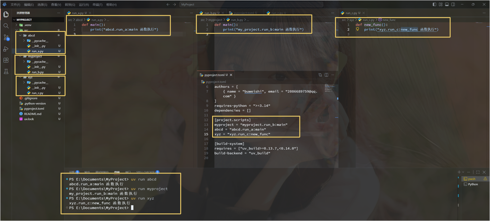

---
tags:
  - type/tutorial
  - lang/python
  - lang/python/uvPorject
  - domain/computer-science
  - domain/computer-science/basic
  - topic/uv_project
  - status/draft
  - source/
aliases:
description:
datetime: " 2026-11-06 15:11:09 周五"
author:
rating:
introduction:
motto: 有志者，事竟成。破釜沉舟，百二秦关终属楚。苦心人，天不负。卧薪尝胆，三千越甲可吞吴。
---
<h1 style="text-align: center;">uvProject</h1>

----

我们在使用 `uv init MyProject` 创建一个项目后，uv 会自动为我们写好项目骨架：


此时如果我们想要在根目录运行整个项目，有两种方式：

1. 将 `__main__.py` 放在某一个包里面，然后 `uv run python -m myproject`:
   

   当然也可以多写几个：
   

2. 不写 `__main__.py`，可以在 `src` 下面的任意包里面写各种不同的逻辑，然后在 `pyproject.toml` 中做好配置，最后再 `uv run src下面相应的包`:
   


关于是否可以同时使用 上述第一个模式和第二个模式：

根据命令的不同自动选择不同的脚本运行！不必担心冲突！！！

------------

补充：一个较好的项目结构：

```
.
├── README.md
├── data
│   └── raw
│       └── part-000001.jsonl
├── docs
├── examples
├── notebooks
├── pyproject.toml
├── scripts
├── src
│   └── learning
│       ├── __init__.py
│       ├── main.py
│       ├── paths.py
│       └── process_data
│           ├── __init__.py
│           └── add_uuid.py
├── tests
└── uv.lock
```

其中：

```
# src.learning.paths

from pathlib import Path

PROJECT_ROOT = Path("__file__").resolve().parent.parent.parent
DATA_DIR = PROJECT_ROOT / "data"


def get_data_path(file_name: str):
    """在任何地方使用本函数, 需要注意: file_name 参数要是 data 下一层一直到文件名的完整路径, 否则解析不正确!"""
    return DATA_DIR / file_name

```

```
# src.learning.main

# 注意是从 learning 开始走起的
from learning.process_data.add_uuid import process


def main():
    process()


if __name__ == "__main__":
    main()

```

```
# src.learning.process_data.add_uuid

from learning.paths import get_data_path


def process():
    print(f"Data 的位置: {str(get_data_path('raw/part-000001.jsonl'))}")

```

```
pyproject.toml

[project]
name = "learning"
version = "0.1.0"
description = "Add your description here"
readme = "README.md"
authors = [
    { name = "bjinwyus", email = "wephiles@163.com" }
]
requires-python = ">=3.14"
dependencies = []

[project.scripts]
learning = "learning.main:main"  <--- 主要看这一行 这里要写到模块下面的函数，不能写 learning = "learning:main" 会报错！

[build-system]
requires = ["uv_build>=0.12.5,<0.13.0"]
build-backend = "uv_build"
```

然后就可以直接运行：

```
uv run learning
```

